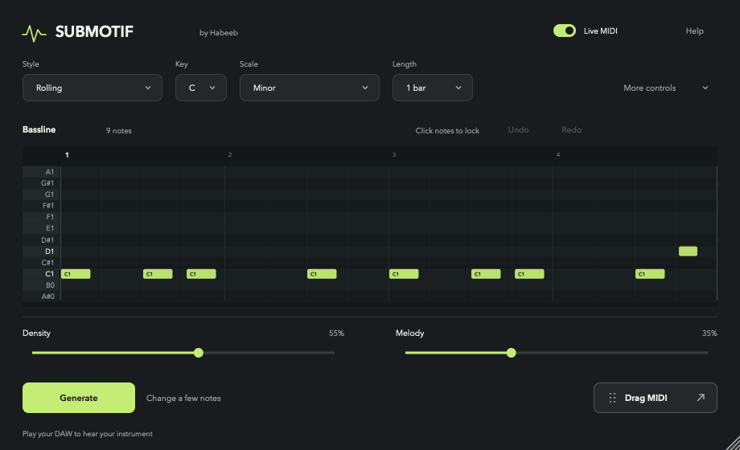

# SUBMOTIF by Habeeb

**A fresh bassline. Your sound.**

SUBMOTIF is a free, open-source MIDI bassline generator for house music. Choose a style, set your key, and generate a phrase for your favorite instrument. Keep what works, change a few notes, and take the MIDI into your track.



**Preview status:** version 1.2.2 is in development. Release packaging and downloads remain on hold pending review. Source, issues, and contributions are available on GitHub. No public release download is available yet.

[Website preview](https://submotif.web.app) · [GitHub](https://github.com/habeebmh/submotif) · [Latest release](https://github.com/habeebmh/submotif/releases/latest) · [Contribute](CONTRIBUTING.md) · [Report an issue](https://github.com/habeebmh/submotif/issues)

Listen to [six selected examples](https://submotif.web.app/#showcase), including Acid through Serum at the approved higher register. These recordings demonstrate MIDI played through instruments; the plugin itself supplies MIDI only.

## Make it yours

Every **Generate** runs the algorithm again. Weighted choices shape a rhythmic motif, assign harmonic roles, and develop a repeating phrase. There is no bank of premade basslines.

- **Six styles:** Deep House, Rolling, Offbeat, Acid, Disco, and Funk.
- **Your instrument supplies the sound.** SUBMOTIF generates MIDI; it has no built-in synthesizer.
- **A simple starting point:** C minor, C1, and one bar. Choose 1, 2, 4, or 8 bars in 4/4.
- **Keep the good parts:** lock notes, make a small variation, undo changes, and save the exact pattern with your project.
- **Keep the MIDI:** drag a pattern from the VST3, create a Live clip from the Max device, or save a MIDI file.

The generation rules draw on research into groove, tonal stability, and melodic continuity. Style weights are design choices, not measurements attributed to those papers. Read the [music theory notes and sources](docs/MUSIC_THEORY.md).

## Choose your edition

| Edition | How it fits your session | Requirements |
| --- | --- | --- |
| **VST3** | Sends MIDI to your instrument. In Ableton Live, use two MIDI tracks. | Current build target: Apple Silicon, macOS 11+, and a VST3 host that exposes plug-in MIDI output. |
| **Max for Live** | Goes directly before your instrument on one Ableton MIDI track. | Live Suite, or Live Standard with Max for Live; Max 9.1.3+. |

The current native build targets Apple Silicon only. Intel, Windows, and other DAWs are not yet verified release targets. See [validation notes](docs/VALIDATION.md) for completed checks and remaining host testing. A passing automated test is not a compatibility guarantee.

Official releases will be free to download from [GitHub Releases](https://github.com/habeebmh/submotif/releases/latest) after review. No payment, follow, or contribution is required. Check the release notes for supported systems, installation instructions, and signing status before installing a build.

## Start in Ableton

### Max for Live: one track

1. Keep `Submotif.amxd`, `undertow.js`, `undertow-core.js`, and `undertow-roll.js` together in one folder. Add that folder to Live's **Places** or copy it into your User Library.
2. Drag **Submotif.amxd** onto a MIDI track, before your bass instrument.
3. Choose a style and key, press **Generate**, enable **Live MIDI**, and start Live's transport.
4. To keep a pattern, select a scene with an empty clip slot on that track and press **Create Clip**. SUBMOTIF switches live generation off. Launch the new clip to hear it.

Create Clip never overwrites an existing clip. **Save MIDI** exports a file instead. See the [Max guide](max/README.md) for setup and timing details; playing an exported clip uses Live's own MIDI scheduling.

### VST3: two tracks

After installing the VST3, enable VST3 folders in Live's plug-in settings and rescan if necessary. Find **SUBMOTIF** under manufacturer **Habeeb**.

1. Put SUBMOTIF on an empty MIDI track and your bass instrument on a second MIDI track.
2. On the instrument track, set **MIDI From** to SUBMOTIF's track, choose **SUBMOTIF** in the lower chooser, and set **Monitor → In**.
3. Press **Generate**, enable **Live MIDI**, and start the transport.
4. Drag **Drag MIDI** onto the instrument track to keep the phrase. Turn SUBMOTIF's **Live MIDI off**, set the instrument track's **Monitor → Auto**, and play the clip.

Clicking **Drag MIDI**, or choosing **Help → Save MIDI**, opens a file export. This setup follows [Ableton's MIDI-output routing instructions](https://help.ableton.com/hc/en-us/articles/209070189-Accessing-the-MIDI-output-of-a-VST-plug-in). Use the Max edition when you want the generator and instrument on the same Live track.

## Shape a phrase

| Control | What it does |
| --- | --- |
| **Style, Key, Scale, Length** | Set the phrase's musical direction. Press Generate to apply changes. Scales include natural minor, Dorian, Phrygian, major, and minor pentatonic. |
| **Density** | Changes how many notes play. |
| **Melody** | Changes how much the pitches move. |
| **Change a few notes** | Keeps the rhythm and most notes while making a small variation. Apply pending settings with Generate first. |
| **Click a note** | Locks or unlocks it. Locked notes survive generation and variation. Shortening a loop removes locks that no longer fit. |
| **More controls** | Reveals Swing, Note length, Register, Root notes only, Start on root, and Octave jumps. |

**Root notes only** keeps new notes on the tonic pitch class; **Octave jumps** permits its upper octave. **Start on root** makes the first sounded note the tonic when that note is unlocked, without moving it onto the downbeat. Locks take priority over new pitch settings. C1 uses Ableton's octave convention: MIDI note 36.

## Build from source

For the native macOS build, install Xcode Command Line Tools, CMake 3.22+, a C++17 compiler, Node.js, and Python 3, then run:

```sh
./scripts/build-macos.sh
```

The script builds the Apple Silicon VST3 and an editor inspection app, then runs the native, Max, and cross-edition checks. The inspection app has no synthesizer. The VST3 is written to `build/Undertow_artefacts/Release/VST3/Submotif.vst3`. The script applies a local development signature; it does not perform Developer ID signing or notarization.

JUCE is pinned in `CMakeLists.txt`. The first configuration fetches it when `.deps/JUCE` is absent, so internet access is needed for that step. Review [third-party notices](THIRD_PARTY_NOTICES.md) before redistributing a build.

For portable generation checks without JUCE, Max, or a DAW:

```sh
cmake -S . -B build-core -DUNDERTOW_CORE_ONLY=ON -DCMAKE_BUILD_TYPE=Release
cmake --build build-core --parallel
ctest --test-dir build-core --output-on-failure
node tests/max-tests.js
python3 tests/generation-parity.py
```

The parity check uses Clang by default; pass `--compiler g++` to use GCC. See [CONTRIBUTING.md](CONTRIBUTING.md) for the code layout and contribution workflow.

## Help shape SUBMOTIF

Musicians, developers, designers, and careful listeners are welcome. Report a reproducible problem, improve instructions, test a host, or propose a focused change. Small contributions are valuable. Start with [the contribution guide](CONTRIBUTING.md) and [open issues](https://github.com/habeebmh/submotif/issues).

If SUBMOTIF helps you make something, an optional [follow on Instagram](https://www.instagram.com/habeeeeeeeeeeeeeeeb/) is a welcome thank-you. Sharing feedback or contributing to the project is welcome too.

## License

SUBMOTIF's original code is licensed under the **GNU Affero General Public License, version 3 only (`AGPL-3.0-only`)**. You may modify it, create forks, and redistribute or sell copies under the license's conditions, including applicable source-sharing requirements. The free official-download policy does not restrict those rights. Read [LICENSE](LICENSE), the [license guide](docs/legal/license-guide.md), and [third-party notices](THIRD_PARTY_NOTICES.md) for the full terms and dependency licenses.

Contributors retain their copyright and contribute under the same AGPLv3-only license. No separate contributor license agreement or copyright assignment is required.

---

[Terms of use](docs/legal/terms.md) · [Liability](docs/legal/liability.md) · [Privacy](docs/legal/privacy.md) · [AGPLv3 license](LICENSE) · [Security](SECURITY.md)
